# Pulse

> A clean, Apple / Logitech Options+–style **system tray app** that shows the **battery level of every connected device** (Bluetooth, Logitech HID++, ASUS ROG), **CPU / GPU load & temperature**, lets you **control fan speeds** and **RGB lighting** (via OpenRGB), and **remembers** your devices and lighting across restarts. A tiny headless agent (.NET 9, plain Win32 tray, ~35–45 MB) stays resident; the Avalonia popover only runs while it is open. Windows first; macOS / Linux planned.

常駐在系統托盤的小工具，點一下就能看到：所有無線裝置的剩餘電量、CPU / GPU 使用率與溫度、風扇轉速（可手動控制），並控制電腦裡的 RGB 燈光；裝置電量、燈光與風扇設定都會記住，重開機後自動還原。介面參考 Apple 與 Logitech Options+：圓角卡片、明亮色彩、淺色 / 深色主題自動切換，全部繁體中文。

常駐的只有一個沒有介面框架的小程式（`Pulse.exe`，閒置時約 35–45 MB 記憶體、單核 1.5–2.5 % CPU）；面板（`Pulse.UI.exe`）只在打開時執行，關掉就結束。

<p align="center">
  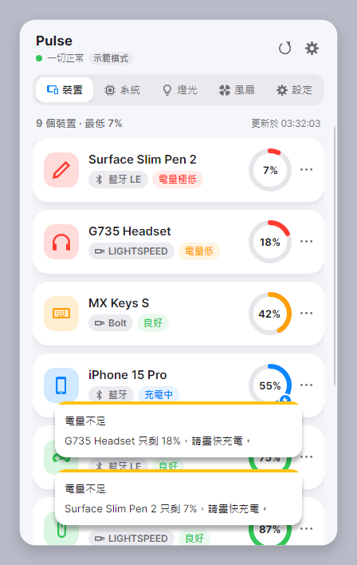
  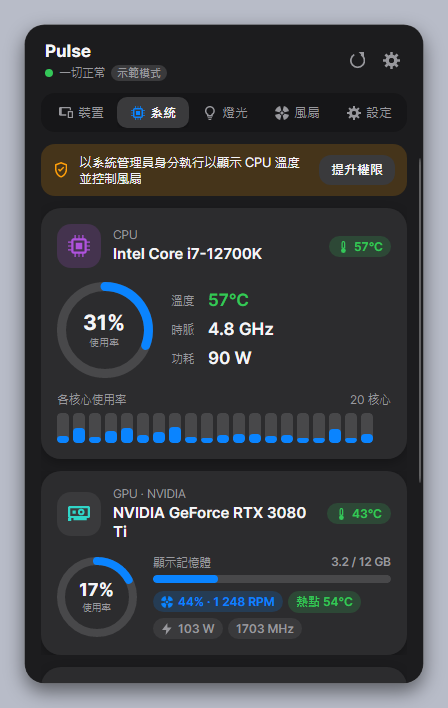
</p>

---

## 目錄

- [功能](#功能)
- [介面](#介面)
- [安裝與執行](#安裝與執行)
- [技術原理](#技術原理)
  - [整體架構](#整體架構)
  - [藍牙裝置電量](#1-藍牙裝置電量windows)
  - [Logitech HID++ 電量](#2-logitech-hid-電量)
  - [ASUS ROG 周邊電量](#3-asus-rog-周邊電量)
  - [CPU / GPU / 風扇](#4-cpu--gpu--風扇librehardwaremonitor)
    - [風扇模式](#風扇模式)
  - [RGB 燈光](#5-rgb-燈光openrgb-sdk)
    - [內建 OpenRGB](#內建-openrgb)
  - [硬體記錄](#6-硬體記錄)
  - [托盤、代理程式與面板](#7-托盤代理程式與面板)
  - [記憶功能](#8-記憶功能statejson)
  - [效能](#9-效能)
- [專案結構](#專案結構)
- [已知限制](#已知限制)
- [規劃](#規劃)
- [授權](#授權)

---

## 功能

| 分頁 | 內容 |
|---|---|
| **裝置** | 所有回報電量的裝置：藍牙 / 藍牙 LE、Logitech（Unifying、LIGHTSPEED、Bolt 接收器與 USB / 藍牙直連）、ASUS ROG 無線鍵盤 / 滑鼠、筆電內建電池。顯示電量環、連線方式、狀態（充電中 / 電量低 / 休眠中 / 未連線）。低電量時跳出提醒 |
| **系統** | CPU 使用率（含每個邏輯核心）、Package 溫度、時脈、功耗；每張 GPU 的使用率、核心 / 熱點溫度、VRAM、風扇、功耗、時脈；記憶體；主機板其他溫度；每顆磁碟一張卡片：溫度、已使用空間、讀寫速度、健康度、累計寫入（NVMe / SSD，含 USB 外接盒，視晶片支援；傳統硬碟不讀取） |
| **燈光** | 透過 OpenRGB 控制主機板、記憶體、顯示卡、鍵鼠等 RGB：一鍵全部套色、每個裝置的模式 / 顏色 / 速度 / 分區顏色；**關燈**（單一裝置或全部）與**還原預設**（回到 Pulse 第一次偵測到裝置時的燈光狀態） |
| **風扇** | 依主機板 / 顯示卡分組列出風扇轉速（沒接風扇的接頭自動隱藏）；四種**風扇模式**：**自動**（全部交回 BIOS / 驅動）、**靜音**（依 CPU / GPU 溫度的低噪音曲線，過熱自動交回 BIOS）、**全部同步**（所有風扇同一轉速）、**個別**（每個風扇手動模式、滑桿與「靜音 / 平衡 / 效能 / 全速」預設）。水冷泵會被自動排除 |
| **設定** | 主題、開機自動啟動、啟動時自動提權、托盤圖示顯示內容、電量更新頻率、OpenRGB 主機 / 連接埠、「使用內建 OpenRGB」與「啟動時還原燈光」、低電量提醒門檻、硬體記錄 |
| **硬體記錄** | 把 CPU / GPU / 記憶體的使用率、溫度、功耗、時脈，以及每個風扇的轉速與控制狀態寫成 CSV（`%LOCALAPPDATA%\Pulse\logs\telemetry.csv`，可用 Excel 開啟；面板開著時每秒一筆、關閉時每 2 秒），**每小時清除一次**並保留前一小時（`telemetry-previous.csv`） |
| **記憶** | 每個裝置最後的電量（關機、休眠或接收器被占用時仍顯示「上次 HH:mm」與最後電量）、你對每個 RGB 裝置做的燈光設定（Pulse 啟動時自動還原一次，例如「除了鍵盤全部關燈」）、低電量提醒是否已經跳過、本次開機的風扇辨識結果 |

托盤圖示本身也是即時資訊：預設顯示**最低的裝置電量**（顏色依電量變化），也可改為 CPU 溫度、GPU 溫度或 CPU 使用率；滑鼠停在圖示上會列出所有裝置與 CPU / GPU 摘要。面板關著時偵測到低電量會跳出 Windows 通知，下次打開面板時也會再提醒一次。

## 介面

點托盤圖示會在螢幕右下角彈出 400 × 660 的圓角面板（約 1–1.5 秒），點其他地方或按 Esc 收起；收起後面板程式就結束，不佔記憶體。

<table>
  <tr>
    <th>裝置</th><th>系統</th><th>燈光</th>
  </tr>
  <tr>
    <td></td>
    <td>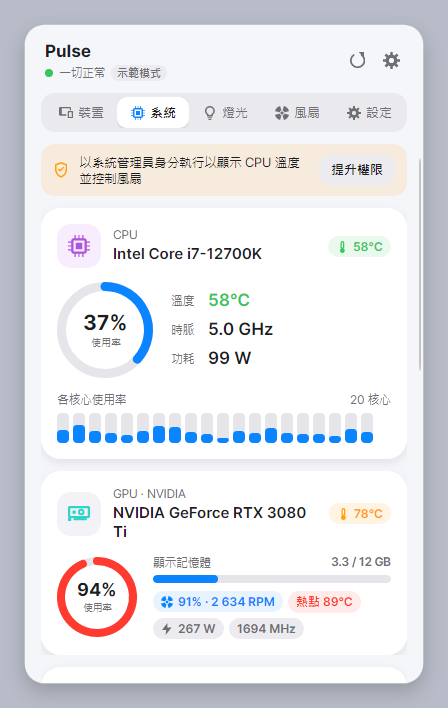</td>
    <td>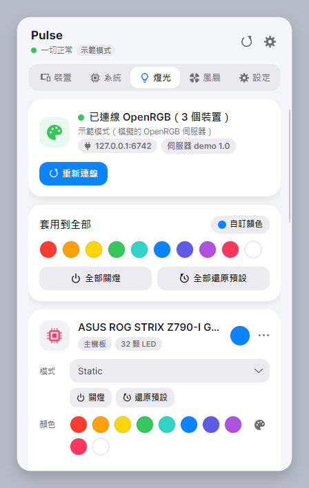</td>
  </tr>
  <tr>
    <th>風扇</th><th>設定</th><th>深色主題</th>
  </tr>
  <tr>
    <td>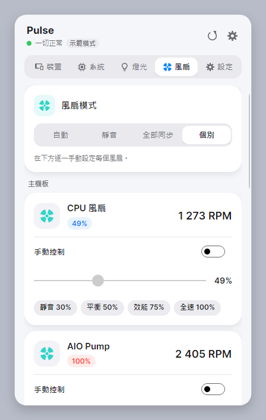</td>
    <td>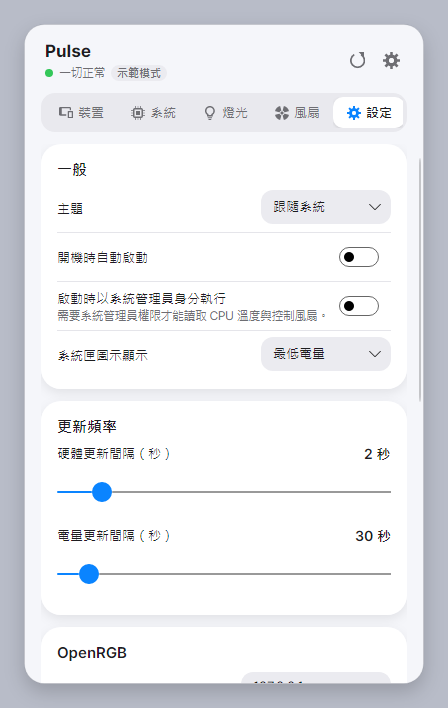</td>
    <td>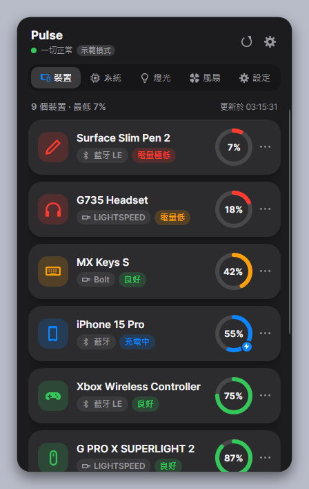</td>
  </tr>
</table>

風扇模式（`tab-fans-quiet.png`、`tab-fans-synced.png`、`tab-fans-auto.png`）：

<table>
  <tr>
    <th>靜音</th><th>全部同步</th><th>自動（深色）</th>
  </tr>
  <tr>
    <td>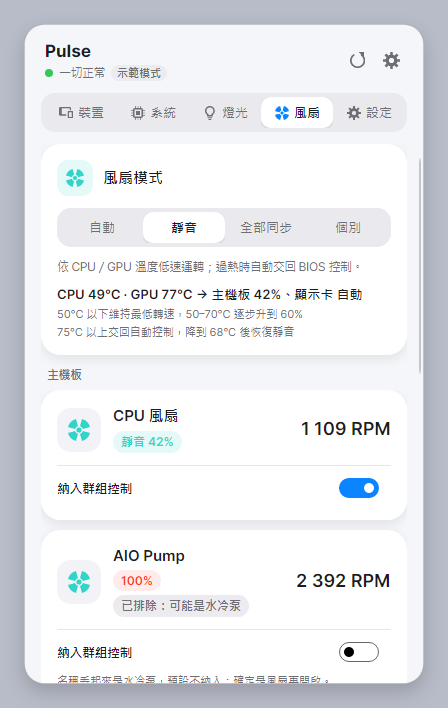</td>
    <td>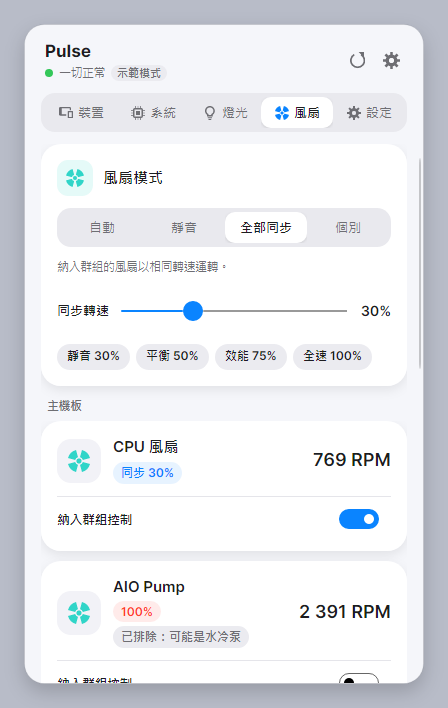</td>
    <td>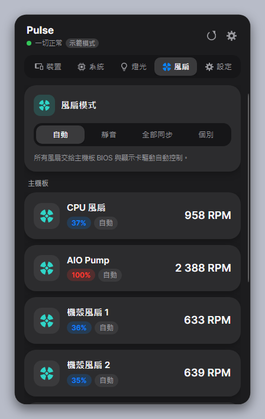</td>
  </tr>
</table>

> 截圖為 `--demo` 示範資料。`docs/screenshots/` 另有每個分頁的深色版與完整捲動高度（`-full`）版本。

設計重點：

- **卡片**：20 px 圓角、16 px 內距、柔和陰影；淺色背景 `#F5F6FA`、深色 `#1C1C1E`。
- **色彩語意**：藍 `#0A84FF`（主色 / 充電）、綠 `#34C759`（良好 / <60 °C）、橘 `#FF9F0A`（注意 / 20–49 % / 60–79 °C）、紅 `#FF3B30`（危險 / <20 % / ≥80 °C）。
- **元件**：自繪電量環（`RingGauge`）、膠囊標籤（`StatPill`）、分段式分頁切換、圓角滑桿與開關。
- 所有顏色都是主題資源（`ThemeDictionaries`），淺色 / 深色即時切換。

## 安裝與執行

### 需求

| 項目 | 說明 |
|---|---|
| 作業系統 | Windows 10 1809+ / Windows 11 |
| 執行階段 | [.NET 9 SDK](https://dotnet.microsoft.com/download/dotnet/9.0)（建置）或 .NET 9 Desktop Runtime（只執行） |
| CPU 溫度 / 風扇控制 | **以系統管理員身分執行**，並安裝 [PawnIO](https://pawnio.eu) 核心驅動。**所有**風扇控制（包含顯示卡風扇）都需要系統管理員權限 |
| RGB 燈光 | Pulse 發行版**內附 OpenRGB**：沒有 OpenRGB 在執行時會自動在背景啟動，不必另外安裝。已經自己裝了 OpenRGB 並開著 SDK Server 也可以，Pulse 會直接連上它。記憶體、顯示卡等走 SMBus 的燈光需要以系統管理員身分執行 |
| Logitech / ASUS 電量 | 透過接收器或 USB 連接即可，可與 G HUB 同時執行 |

### 執行

```powershell
git clone https://github.com/alextixu/pulse-monitor.git
cd pulse-monitor

.\run.ps1          # 一般權限：電量、GPU、燈光
.\run-admin.ps1    # 系統管理員：再加上 CPU 溫度與風扇控制（會跳 UAC）
.\run.ps1 -Demo    # 只開面板、示範資料，不碰硬體
```

`run.ps1` 會把代理程式與面板發行到 `artifacts\dev`（兩者必須放在同一個資料夾，代理程式才找得到面板）再啟動 `Pulse.exe`。

| 程式 | 參數 | 功能 |
|---|---|---|
| `Pulse.exe` | `--minimized` | 啟動後只顯示托盤圖示（開機自動啟動使用） |
| | `--show-ui`、`--tab <分頁>` | 啟動後打開面板（到指定分頁） |
| | `--quit` | 通知正在執行的 Pulse 正常結束（先把風扇交回自動）並等它結束；不要用工作管理員強制結束改過風扇的 Pulse |
| `Pulse.UI.exe` | `--demo` | 面板自己帶一個使用示範資料的引擎，不需要代理程式、不碰硬體與使用者檔案 |
| | `--screenshot <資料夾>` | 把五個分頁（淺色 + 深色）與風扇三種模式輸出成 PNG 後結束（示範資料） |

發行（含內建 OpenRGB）：

```powershell
.\tools\fetch-openrgb.ps1        # 把 OpenRGB 放到 third_party\OpenRGB（預設從 C:\Program Files\OpenRGB 複製；或 -ZipUrl 下載官方 zip）
.\tools\publish.ps1              # 代理程式與面板一起發行到 publish\win-x64
.\tools\publish.ps1 -Deploy      # 先 --quit 正在執行的 Pulse、發行、再由排程工作啟動
```

登入時自動以系統管理員身分啟動（工作排程器，不會每次跳 UAC）：

```powershell
.\tools\install-pulse.ps1              # 註冊「Pulse」排程工作並啟動 publish\win-x64\Pulse.exe --minimized
.\tools\install-pulse.ps1 -Uninstall   # 移除（先用 Pulse.exe --quit 關閉）
```

建議用這個方式長期執行：由排程服務啟動的 Pulse 不屬於其他程式。實際發生過的情況是，從 Microsoft Store 版應用程式（例如 Claude 桌面版）的終端機啟動 Pulse 時，Windows 會把 Pulse 當成該套件的一部分：套件更新時連同 Pulse 一起被強制關閉（風扇因此停在當下的轉速），設定檔與登錄機碼也會被導向到套件自己的資料夾。排程工作另外會在 Pulse 當機（Windows 記錄「Application Error」）10 秒後自動重新啟動它：實際發生過 NVIDIA 驅動更新時 NVML 在 Pulse 裡當掉、之後六小時沒有任何東西把它叫回來。設定中「開機時自動啟動」若偵測到這個排程工作，就不會再額外寫入登錄機碼（避免每次登入啟動兩份）。

`third_party\OpenRGB\` 不進 git；有這個資料夾時，發行會自動把它連同 `NOTICE.md`、`LICENSE-GPL-2.0.txt` 放到輸出資料夾的 `OpenRGB\`。沒有的話 Pulse 照常建置，只是不附帶 OpenRGB。

| 檔案 | 位置 |
|---|---|
| 設定 | `%APPDATA%\Pulse\settings.json` |
| 記憶（電量、燈光、風扇、提醒） | `%LOCALAPPDATA%\Pulse\state.json` |
| RGB 預設燈光 | `%APPDATA%\Pulse\rgb-defaults.json` |
| 風扇當機復原 | `%LOCALAPPDATA%\Pulse\fan-recovery.json` |
| 記錄檔 | `%LOCALAPPDATA%\Pulse\logs\app.log`（代理程式）、`ui.log`（面板） |
| 硬體記錄 | `%LOCALAPPDATA%\Pulse\logs\telemetry.csv` |

> 記憶體吃緊時（例如一邊玩遊戲一邊建置），Avalonia 的 XAML 編譯器可能出現 OutOfMemory。改用單一行程建置：`dotnet build Pulse.sln -m:1 -nodeReuse:false`。測試：`dotnet test tests\Pulse.Core.Tests`、`dotnet test tests\Pulse.Engine.Tests`。

---

## 技術原理

### 整體架構

兩個程式：常駐的**代理程式** `Pulse.exe`（沒有介面框架）與只在打開時執行的**面板** `Pulse.UI.exe`（Avalonia），透過 named pipe 溝通。

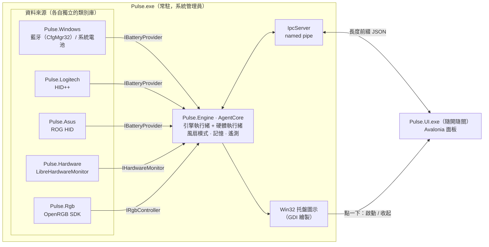

- **`Pulse.Core`** 定義所有契約：資料來源介面（`IBatteryProvider`、`IHardwareMonitor`、`IRgbController`）、引擎介面 **`IPulseAgent`**（狀態快照、事件、指令）、pipe 訊息與 JSON source generator、托盤圖示規則、記憶檔格式與所有中文字串。
- **`Pulse.Engine`**（`AgentCore`）取代舊版的 `MonitoringService` / `FanModeService` / `SettingsService`：一條**引擎執行緒**擁有所有狀態並發出所有事件；一條專用的**硬體執行緒**讀取感測器（面板開著時每秒、關閉時每 2 秒）、執行風扇模式並處理手動風扇寫入（所以所有風扇寫入都在同一條執行緒）；電量每 30 秒輪詢，每個 provider 各自逾時與錯誤隔離。設定只由引擎寫入，面板送來的是「單一屬性」的修改（`SettingsPatch`），舊的面板副本不可能蓋掉引擎剛改過的值。
- **`Pulse.Agent`**（`Pulse.exe`）組合所有 provider、單一執行個體與 `--quit`、Win32 托盤、pipe 伺服器、關機時把風扇交回。
- **`Pulse.App`**（`Pulse.UI.exe`）只是 `IPulseAgent` 的用戶端：`IpcPulseClient` 透過 pipe 實作同一個介面；`--demo` / `--screenshot` 時直接在面板裡建立一個使用示範資料的 `AgentCore`（不需要代理程式、不寫入使用者檔案）。

### 1. 藍牙裝置電量（Windows）

Windows 的藍牙堆疊會讀取裝置的電量（BLE 的 GATT Battery Service、經典藍牙的 HFP 電量回報），並快取在裝置節點的屬性 **`DEVPKEY_Bluetooth_Battery`**（`{104EA319-6EE2-4701-BD47-8DDBF425BBE5} 2`，1 byte 百分比）。設定 › 藍牙頁面顯示的電量就是這個值。

1. 用 **CfgMgr32**（`CM_Get_Device_ID_ListW`）列出 `BTHENUM` 與 `BTHLE` 底下的裝置節點，包含已配對但目前沒連線的「phantom」節點，所以關機中的手把仍會顯示 Windows 快取的電量。
2. 每個節點讀 `DEVPKEY_Bluetooth_Battery`（沒有時往下找它的服務子節點，例如 BLE 的 Battery Service `0x180F`）、名稱、`DEVPKEY_Bluetooth_DeviceAddress`、Class of Device 與裝置容器類別；連線狀態看節點狀態（已啟動、沒有問題碼、沒有 `DN_DEVICE_DISCONNECTED`）。
3. 同一個位址的經典藍牙與 BLE 節點合併成一張卡片；裝置類型依 Class of Device → 容器類別 → 名稱關鍵字推斷。

不主動連線讀 GATT，所以不會干擾裝置原本的驅動程式；代價是只拿得到 Windows 有快取的電量。早期版本用 WinRT（`DeviceInformation` / `PnpObject`），光是那層投影就讓發行資料夾多了 24 MB、每次掃描約 100 ms；CfgMgr32 版本一次掃描不到 1 ms。

### 2. Logitech HID++ 電量

Logitech 的無線接收器與裝置使用 **HID++** 協定（與 Solaar、logiops 相同），透過廠商自訂 HID 集合（usage page `0xFF00`）交換報告：

- 短報告 `0x10`（7 bytes）、長報告 `0x11`（20 bytes）。Windows 會把每個 top-level collection 拆成獨立的 HID 裝置，所以要同時開啟同一介面的短、長兩個集合，在背景執行緒讀取並依（裝置索引、feature index、software id）配對回覆。
- **探測**：對索引 `0xFF` 送 Root feature 的 ping。回 HID++ 2.0 版本號代表是直連裝置；回 HID++ 1.0 錯誤（`0x8F`）代表是接收器，再讀接收器暫存器 `0xB5` 取得每個配對槽（1–6）的裝置名稱、類型、序號。
- **Feature 探索**：HID++ 2.0 的功能是動態索引的，先以 Root `getFeature(featureId)` 查出 `DEVICE_NAME (0x0005)`、`DEVICE_FW_VERSION (0x0003)`、電量功能的索引並快取。
- **電量**：依序嘗試 `UNIFIED_BATTERY (0x1004)`（百分比 + 充電狀態）、`BATTERY_STATUS (0x1000)`、`BATTERY_VOLTAGE (0x1001)`（電壓查表換算百分比）；HID++ 1.0 裝置用暫存器 `0x0D` / `0x07`。
- 休眠的裝置會讓接收器立刻回錯誤碼 `0x09`，因此列為「休眠中」並保留最後電量，不會等待逾時。首次探索約 130 ms，之後每次輪詢只需 1–8 ms。

### 3. ASUS ROG 周邊電量

ROG 無線鍵盤（如 Falchion）的 2.4 GHz 接收器會提供一個廠商 HID 集合（usage page `0xFF00`，64 bytes、無 report ID），使用與 OpenRGB「TUF 鍵盤」相同的指令框架：寫入 `[cmd, sub, 0…]`，回覆前兩個 byte 會回傳相同的 `cmd, sub`，被拒絕時則回 `FF AA`。

| 指令 | 用途 | 回覆 |
|---|---|---|
| `12 00` | 韌體版本（同時用來判斷裝置是否支援此協定） | 例如 `12 00 00 00 01 00 03 …` → 3.00.01 |
| `12 01` | 鍵盤狀態 | **byte 10 = 電量百分比**，byte 11–12 疑似電池電壓（mV，小端序） |
| `12 07` | ROG 滑鼠電量（依 rogdrv 實作，尚未實機驗證） | byte 4 = 百分比 |

`12 01` 的電量位置是在實機上比對鍵盤自身的電量顯示（約 100 %）找出來的。為了安全，只會對產品名稱含 ROG / TUF 的裝置送出唯讀的 `12 xx` 查詢，並明確排除主機板的 AURA 燈控（例如 `0B05:19AF`）。不支援此協定的裝置會在 2 分鐘內不再詢問。

### 4. CPU / GPU / 風扇（LibreHardwareMonitor）

使用 [LibreHardwareMonitorLib](https://github.com/LibreHardwareMonitor/LibreHardwareMonitor)：

- **CPU 溫度**需讀取 MSR 暫存器（例如 Intel 的 `IA32_PACKAGE_THERM_STATUS`），**主機板風扇**需存取 Super I/O 晶片（例如 Nuvoton NCT67xx）的 I/O port，兩者都需要核心驅動。LHM 0.9.6 使用 **PawnIO**（舊的 WinRing0 在 Windows「記憶體完整性」開啟時會被封鎖），而且程式必須以系統管理員身分執行。
- **GPU** 走廠商 API（NVIDIA NVAPI / NVML、AMD ADL），不需要管理員權限，數值與 `nvidia-smi` 一致。
- 每次快照以 `IVisitor` 走訪整棵感測器樹並呼叫 `Update()`，一次走訪就組出 `HardwareSnapshot`（約 110 ms，其中大部分是在等硬體回應）。Alder Lake 的 P-core / E-core 與 `Core #n Thread #m` 命名都有處理。
- **讀取成本**：每 5 分鐘記錄檔會有一行 `Poll stats`，列出每個硬體節點的平均耗時與實際 CPU 時間、整個程序的 CPU、記憶體、執行緒數。實測一次 NVIDIA 顯示卡讀取約 70 ms、其中約 30 ms 是 CPU（驅動程式 API 本身的成本）；ASUS 主機板的 Embedded Controller 每次約 45 ms 都在等 EC 回應，它只提供主機板溫度，所以和磁碟、DIMM 溫度一樣**每 10 秒**才讀一次。
- LHM 預設會替每個感測器保留**一天**的歷史值，1 秒輪詢時程序每小時會多出約 3 MB；Pulse 把每個感測器的 `ValuesTimeWindow` 設為 0。
- **顯示卡驅動更新保護**：驅動程式被重新安裝時，NVML 呼叫會在 Pulse 裡發生 .NET 無法攔截的存取違規（實際發生過，風扇因此沒能交回）。Windows 在驅動被換掉前會廣播裝置變更，代理程式收到後暫停讀取顯示卡 15 秒，期間沿用上一筆數值。
- **風扇控制**：把 `SensorType.Fan`（轉速）與同一硬體上相同索引的 `SensorType.Control`（PWM 工作週期）配對，再透過 `IControl.SetSoftware(%)` 設定轉速、`SetDefault()` 交回韌體曲線。數值會限制在硬體回報的範圍內（例如 NVIDIA 最低 30 %）。程式結束時會還原所有被改過的風扇。
- 所有 LHM 呼叫都用同一把鎖序列化，因為 LHM 不是執行緒安全的。
- **磁碟卡片**：開啟 LHM 的儲存裝置監控，每顆磁碟對應一張卡片（`HardwareSnapshot.Storages`）。各磁碟後端的感測器名稱不同，因此用類型加關鍵字對應：溫度取 NVMe 的 `Composite Temperature`（沒有時取 `Temperature`）；已使用空間取 Load「Used Space」；讀寫速度取 Throughput「Read / Write Rate」；健康度取 Level「Life」，或以 100 −「Percentage Used」換算；累計寫入取 Data「Data Written」。介面類型（NVMe / SATA / USB）與是否為 HDD 來自儲存堆疊快取的描述資料：以「不讀也不寫」的權限開啟 `\\.\PhysicalDriveN`，送 `IOCTL_STORAGE_QUERY_PROPERTY` 查詢裝置描述與「是否有尋軌延遲」（有 = 硬碟）。這不會對磁碟送出命令、不需要 WMI 也不需要系統管理員，約 1 ms；查不到時一律不讀任何磁碟的 SMART。型號比對時忽略空格與連字號（例如「ADATA SX 8200PNP」對「ADATA SX8200PNP」）。SMART 查詢較慢，所以磁碟最多每 10 秒更新一次；**傳統硬碟（HDD）不讀取**，因為 SMART 查詢可能把休眠中的硬碟喚醒，卡片上會說明原因。磁碟溫度門檻比 CPU 嚴格（&lt; 55 °C 綠、55–69 °C 橘、≥ 70 °C 紅）。啟動時記錄檔會列出每顆磁碟的所有感測器（`Storage sensors:`），方便對照新機型。每秒記錄也包含每顆磁碟的溫度與讀寫 MB/s。

未以管理員執行時，狀態會顯示為「降級」，並在介面上提供「以系統管理員身分重新啟動」（`ShellExecute` + `runas`，帶 `--elevated-relaunch` 參數避免重複提權）。

**沒有管理員權限時所有風扇都只能監測。** 實測：一般權限下 LHM 仍把顯示卡風扇回報為「可控制」，`SetSoftware(60)` 也不會報錯，但轉速完全不變（維持 53 % / 1000 RPM）；以管理員執行時同一個呼叫立刻生效（100 % → 2916 RPM）。所以 Pulse 在 Windows 未提權時把每個風扇都標成不可控制，介面顯示提權提示，而不是假裝設定成功。

啟動完成後記錄檔會有一行 `Fans (n, control allowed: …)`，列出每個風扇的 id、名稱、分組、轉速、工作週期、最小 / 最大值與是否可控制，方便對照主機板上的接頭（Super I/O 的名稱常常只是 `Fan #1`）。

#### 風扇模式

風扇分頁最上方的「風扇模式」卡片決定 Pulse 怎麼控制**可控制**的風扇。模式與群組設定會儲存在 `settings.json`（`FanMode`、`SyncedFanPercent`、`FanGroupExcludedIds`、`FanGroupIncludedIds`）。邏輯集中在 `Pulse.Core/FanControl`（`QuietFanCurve`、`FanGroupPolicy`、`FanPresenceTracker`、`FanModeController`），由引擎的硬體執行緒在每次讀取感測器後套用。面板送來的手動轉速也由引擎檢查：只有「個別」模式、可控制、不是孤兒（見下方）的風扇才會被寫入，其他情況直接回覆錯誤。

| 模式 | 行為 |
|---|---|
| **自動** | 切換時把所有 Pulse 控制中的風扇（包括「個別」模式手動設定的）交回韌體（`SetDefault`），之後不再寫入 |
| **靜音** | 依溫度曲線控制群組內的風扇（見下方） |
| **全部同步** | 群組內所有風扇使用同一個轉速（滑桿或「靜音 30 / 平衡 50 / 效能 75 / 全速 100」，300 ms 防抖動），並限制在每個風扇的最小 / 最大值內（例如顯示卡最低 30 %）。只有目標改變，或風扇實際轉速被其他軟體改動、偏離 ≥ 5 % 時才會重新寫入 |
| **個別**（預設） | 原本的每個風扇卡片：手動開關、滑桿與預設值 |

**切換模式或把風扇排除出群組時，一律先把受影響的風扇交回韌體，再套用新模式。**

**靜音曲線**（溫度來源：顯示卡風扇用該顯示卡的核心溫度，其他風扇用 CPU Package 溫度；CPU 在 80 °C 以下都維持低轉速）：

| | 主機板風扇（依 CPU Package 溫度） | 顯示卡風扇（依 GPU 核心溫度） |
|---|---|---|
| 最低轉速 | max(風扇最小值, 35 %)，**≤ 75 °C** 都維持 | max(風扇最小值, 30 %)，≤ 50 °C |
| 緩升 | 75–80 °C 線性升到 50 % | 50–70 °C 線性升到 60 %（70–75 °C 維持 60 %） |
| **交回自動** | **≥ 80 °C** 立即交回 BIOS，降到 **≤ 72 °C** 才恢復 | **≥ 75 °C** 立即交回驅動，降到 **≤ 68 °C** 才恢復 |
| 讀不到溫度 | 交回自動控制 | 交回自動控制 |

（交回與恢復之間的溫差是遲滯，避免在門檻附近來回切換。）

**溫度平滑**：遊戲時 CPU Package 溫度會在一兩秒內跳動 10 °C 以上（實測 71 → 82 → 71 °C），直接拿瞬間值判斷會讓風扇每幾秒就在 BIOS 曲線與 35 % 之間切換。因此曲線與「交回自動」都使用時間常數約 10 秒的指數移動平均（`TemperatureSmoother`）：

- 持續高溫約 10 秒才會交回（例如一直維持 85 °C）；瞬間尖峰不會觸發。
- **緊急保護**：只要單次讀值達到 CPU 90 °C、GPU 85 °C，就不等平滑、立即交回。
- 交回後至少 **30 秒**才可能恢復靜音（同時平滑溫度要降到恢復門檻以下）。
- 實測：CPU 在 64–85 °C 之間跳動的 40 秒內，交回次數從原本的每幾秒一次降為 0。

為了不讓風扇忽快忽慢，靜音模式只在新轉速與上次寫入相差 ≥ 3 % 時才寫入，且每個風扇最多每 4 秒寫一次；交回韌體則永遠立即執行。

**群組成員**：可控制的風扇預設都會參與「靜音」與「全部同步」，每張風扇卡片上有「納入群組控制」開關。沒有手動設定過的風扇會套用**水冷泵排除規則**：名稱包含 `pump`、`泵` 或 `AIO`（不分大小寫），或是本次啟動第一次看到它時轉速就 ≥ 2800 RPM（一般 120/140 mm 風扇最高約 1500–2000 RPM，水冷泵常在 2500–4500 RPM），或以 ≥ 95 % 工作週期、≥ 1800 RPM 全速運轉；顯示卡風扇不套用轉速規則。被排除的原因會顯示在卡片上；手動打開開關（`FanGroupIncludedIds`）可以覆蓋這個規則，手動關閉則記錄在 `FanGroupExcludedIds`。

**隱藏沒接風扇的接頭**：主機板 Super I/O 會回報每個接頭（例如 NCT6798D 有 7 個），沒接風扇的接頭轉速永遠是 0。非顯示卡風扇在前 3 次取樣都沒有轉速（0 或無值）就會被隱藏、也永遠不會被寫入；一旦回報轉速 > 0 就會出現，並在本次執行期間一直顯示。顯示卡風扇可能處於 0 RPM 停轉模式，所以永遠顯示。隱藏的數量會顯示在風扇列表最下方（「已隱藏 n 個未接風扇的接頭」）。

**結束與當機復原**：

- 正常結束時（托盤「結束」、面板「結束」、`--quit`、Windows 登出 / 關機），引擎**第一步**就停止風扇模式並由 `IHardwareMonitor.Dispose()` 把所有改過的風扇交回韌體，之後才通知面板、寫入記錄與記憶檔、關閉 OpenRGB。登出 / 關機時代理程式會以「正在把風扇交回 BIOS…」暫時擋住關機，直到風扇交回（最多約 6 秒）。未處理的例外與程序結束事件只做「停止風扇模式 + 交回風扇」這兩件事，不碰任何其他執行緒或檔案。
- 引擎在 30 秒內都沒拿到新的感測器資料時，會把硬體狀態標成失敗、停止寫入風扇；資料恢復後自動繼續。
- 每次把風扇設成手動，Pulse 都會寫入 `%LOCALAPPDATA%\Pulse\fan-recovery.json`；正常交回後刪除。若上次被強制結束或當機，下次啟動時：**顯示卡風扇**會自動交回驅動（NVAPI 的「預設」隨時有效）；**主機板 Super I/O 風扇**只能由當初改它的那個程序還原，所以 Pulse 只能在風扇分頁提示「請重新開機」以恢復 BIOS 曲線（或在「個別」模式自行設定）。
- 因此要關閉改過風扇的 Pulse，請用托盤選單的「結束」或 `Pulse.exe --quit`，不要強制結束程序。
- **重新開機前由 Pulse 代管**：LHM 的 `SetDefault` 只會還原「這個程序第一次改寫前」看到的狀態。被強制結束後，新的 Pulse 第一次改寫時看到的已經是卡住的手動轉速，所以這時再「交回韌體」反而會把風扇固定回那個低轉速（實際發生過：CPU 89 °C 時交回，風扇卻停在 35 %）。因此這些風扇會被記為「孤兒」（連同開機時間存在 `fan-recovery.json`，Pulse 重開也記得，重新開機後自動清除），在任何模式下都**不會被交回**，改由 Pulse 的代管曲線控制：≤ 50 °C 40 %、70 °C 60 %、80 °C 85 %、≥ 85 °C 100 %（疑似水冷泵或讀不到溫度時 100 %；升溫立即生效、降溫才節流）。靜音 / 全部同步模式在溫度正常時照常運作，只有原本要交回的時候改用代管曲線；個別模式下這些風扇不提供手動控制。Pulse 結束時把它們留在 100 %，風扇卡片顯示「代管 xx%（重開機後恢復 BIOS）」。

### 5. RGB 燈光（OpenRGB SDK）

各家 RGB 協定差異很大，所以 Pulse 不自己實作驅動，而是透過 [OpenRGB](https://openrgb.org) 的 **SDK Server**（TCP `127.0.0.1:6742`）控制所有 OpenRGB 支援的裝置：

- 每個封包是 16 bytes 標頭（`"ORGB"` magic、device id、packet id、資料長度）加上資料。主要使用 `REQUEST_CONTROLLER_COUNT (0)`、`REQUEST_CONTROLLER_DATA (1)`、`UPDATELEDS (1050)`、`UPDATEZONELEDS (1051)`、`UPDATEMODE (1101)`，並與伺服器協商使用 protocol v4。
- **設定單一顏色**：裝置有 `Direct` 模式時切換到 Direct 再寫入每顆 LED；否則使用帶顏色參數的 `Static` 模式。
- **關燈**：裝置有名為 `Off` 的模式（不分大小寫）時直接切換到該模式；沒有的話就走上面的單色路徑，把每顆 LED 設成 `#000000`。「全部關燈」會逐一處理每個裝置，單一裝置失敗只記錄並略過。
- **還原預設**：Pulse **第一次看到某個裝置**（連線或重新整理裝置清單時）會記錄它當下的狀態：目前模式的索引與名稱、該模式的速度 / 方向 / 顏色模式與模式顏色，以及每顆 LED 的顏色，存在 `%APPDATA%\Pulse\rgb-defaults.json`（以暫存檔寫入再搬移，檔案遺失或損毀時會重新建立，損毀的檔案另存為 `.corrupt`）。裝置以「名稱 + Location + Serial」識別（兩者皆空時改用「名稱 + 類型 + LED 數」）；HID 裝置的 Location 是 Windows 裝置路徑，其中由系統產生的執行個體片段（例如 `8&1b8da785&0&0000`）在接收器換插槽或重新列舉時會改變，所以會被去掉，舊的紀錄啟動時自動搬到新的識別碼。已有紀錄的裝置**不會再被覆寫**；裝置當下是「關燈」或全黑時也不會被記成預設。若想改用目前的燈光當作預設，可在裝置卡片的「…」選單選「將目前狀態設為預設」。
  - 還原時先依名稱（其次索引）找回原本的模式，以 `UPDATEMODE` 帶回速度、方向與模式顏色；若原本是逐顆 LED 的 `Direct` 模式，再以 `UPDATELEDS` 寫回每顆 LED 的顏色。
  - 沒有紀錄（或原本的模式已不存在）時，改切換到第一個不是 Direct / Static / Off 的韌體燈效（通常是 Rainbow / Spectrum Cycle）；連這種模式都沒有就不做任何事，並在狀態列說明原因。
- **切換模式（OpenRGB 1.0 相容）**：OpenRGB 1.0 會用 `SetModeValuesFromMode` 驗證收到的模式，例如沒有方向設定的模式（Direct、Static、Off）方向值必須是 0，亮度、速度、顏色數也必須在範圍內，不合格就**靜默丟棄**。OpenRGB.NET 3.1.1 對這類模式送出的方向是 `0xFFFFFFFF`，而且不允許呼叫端修改，所以切到 Direct / Static / Off 全都沒有效果。Pulse 因此：
  - 切到 Direct（不帶參數）用 `SETCUSTOMMODE`；
  - 其他模式由 `OpenRgbModePacket` 自己組 `UPDATEMODE` 封包（同樣的格式，但方向、亮度、速度、顏色模式都填合法值），寫在 OpenRGB.NET 的同一條連線上（protocol v4 的用戶端不會收到 ACK，所以不影響函式庫的讀取）；這也讓亮度可以設定；
  - 每次切換後**重新讀取裝置確認**（最多約 0.9 秒），沒切過去就在介面上回報「OpenRGB 沒有套用…」，不再假設成功。關燈時 `Off` 被拒就改用 Direct + 全黑。
  - 實測（OpenRGB 1.0）：記憶體 Rainbow / Static、顯示卡與主機板 Off 都能切換，每個動作約 0–150 ms。
- 用戶端是 [OpenRGB.NET](https://github.com/diogotr7/OpenRGB.NET) 3.1.1。實測發現 OpenRGB 關閉後，這個函式庫的 `Connected` 屬性仍會維持 `true`，而且讀取迴圈會讓一個 CPU 核心空轉到 100 %。所以 Pulse 會每 2 秒以及每次呼叫前直接檢查底層 socket（`OpenRgbClientProbe`），一旦發現斷線就丟棄用戶端並在介面上提示。
- 每個操作都有逾時與取消機制，並以 `SemaphoreSlim` 序列化；連不上時面板會顯示安裝與啟用 SDK Server 的步驟。

#### 內建 OpenRGB

OpenRGB 支援數百種裝置，而記憶體、顯示卡燈光要經過 SMBus / I²C，自己重寫風險很高，所以 Pulse 選擇**隨附 OpenRGB 並把它當成背景服務**，而不是複製它的程式碼：

1. 連線前（引擎的 `RgbService`），`OpenRgbServerLauncher` 先試連 SDK 埠。已經有 OpenRGB 在聽（使用者自己開的）就直接使用，Pulse 不會去關它；這次執行期間之後斷線也只會重新連線，不會改啟動內建的那份去搶裝置。連線中斷時以 5 秒、15 秒、60 秒、之後每 5 分鐘的間隔重連。
2. 沒有的話，且「使用內建 OpenRGB」開著、主機是本機，就啟動 `<Pulse 資料夾>\OpenRGB\OpenRGB.exe --server --server-port 6742 --noautoconnect`：只開 SDK 伺服器、沒有視窗，等埠開啟（最多 30 秒）後再連線。
3. OpenRGB 會先開埠、再慢慢偵測裝置，所以 Pulse 在之後 30 秒內每 2 秒重讀一次裝置清單，數量有變就更新燈光分頁。
4. Pulse 以 **Job Object（kill-on-close）** 綁住這個 OpenRGB：Pulse 正常結束時主動關掉它；就算 Pulse 被強制結束或當機，Windows 也會一併結束它，不會殘留在背景。
5. 子程序繼承 Pulse 的權限：以系統管理員身分執行時，OpenRGB 才能經由 PawnIO 存取 SMBus（記憶體燈光）。

授權：OpenRGB 是 GPL-2.0，Pulse 是 MIT。兩者是獨立程式、只透過 TCP 溝通，沒有互相連結，所以可以一起散佈；發行資料夾的 `OpenRGB\` 內附 `NOTICE.md`（作者、原始碼位置）、`LICENSE-GPL-2.0.txt` 與 `SOURCE.txt`（這份副本的來源與 SHA-256）。

### 6. 硬體記錄

`TelemetryLogger` 在引擎每次發佈硬體快照時（面板開著每秒、關閉時每 2 秒）把一行 CSV 放進有上限的佇列，由背景執行緒寫檔：

- 欄位：時間、硬體狀態、風扇模式、CPU 使用率 / 溫度 / 最高核心溫度 / 時脈 / 功耗、每張 GPU 的使用率 / 溫度 / 熱點 / 顯存溫度 / 功耗 / 時脈 / 顯存用量、記憶體用量，以及每個**偵測到的**風扇（轉速、工作週期、風扇模式狀態）與主機板其他溫度。
- 欄位在檔案開始時決定：先收集 4 筆樣本，等「沒接風扇的接頭」判定完成再寫表頭，所以不會出現永遠是 0 的風扇欄位。
- **每到整點清除**：目前的檔案改名為 `telemetry-previous.csv`（覆蓋更早的那份），再開新檔；每次啟動 Pulse 也會先把舊檔移過去。磁碟上最多約兩小時的資料。
- 檔案是 UTF-8（含 BOM），Excel 開啟中文欄位名稱不會亂碼；寫入時允許其他程式同時讀取。
- 示範模式不寫入。設定 › 硬體記錄可以關閉。

### 7. 托盤、代理程式與面板

- **托盤圖示**：代理程式用一個隱藏的 Win32 視窗與 `Shell_NotifyIcon`（NOTIFYICON_VERSION_4）擁有圖示，沒有載入任何 UI 框架。圖示以**純 GDI** 繪製 32 × 32（彩色圓環、圓角弧線、置中粗體數字，或電池圖示）再用 `CreateIconIndirect` 建立，每次換圖後立刻 `DestroyIcon` 舊的，所以 GDI / USER 物件數不會增加（舊版用 Avalonia `WindowIcon`，每秒建立新圖示，約 29 小時後耗盡每個程序 10 000 個物件的上限）。實測一次繪製約 0.17 ms。只有內容真的改變才更新，並合併 400 ms 內的變化。
- **選單**與舊版相同：開啟 / 重新整理 /（未提權時）以系統管理員身分重新啟動 / 設定 / 結束。Explorer 重新啟動時圖示會自動加回；USB 裝置插拔時通知引擎（Logitech 重試、暫停讀取顯示卡）。
- **點一下圖示**：面板開著就收起；沒開就啟動同資料夾的 `Pulse.UI.exe --popover`（防止 3 秒內重複啟動），面板剛因為失去焦點而收起的 350 ms 內再點不會重新打開。
- **面板**（Avalonia 11、Fluent 主題、CommunityToolkit.Mvvm、compiled bindings）：無邊框、透明背景、永遠置頂，依工作區與 DPI 放在右下角。啟動後立刻顯示（主題取自上次的 `ui-state.json`），收到代理程式的初始資料後再填入；只有面板顯示時代理程式才會每秒推送硬體資料。收起時先把滑桿等待中的修改送出，然後整個程式結束，所以平常不佔記憶體。
- **Pipe**：`Pulse.Agent.<網域>.<使用者>.<工作階段>`，位元組模式、4 bytes 長度前綴 + UTF-8 JSON（source generator，型別鑑別欄位 `t`）。只有目前使用者能連線，並加上 medium integrity 標籤，讓一般權限的面板也能連到以系統管理員身分執行的代理程式。每個連線一個寫入工作：硬體 / 電量畫面只保留最新一筆，其他訊息（回覆、設定、狀態）依序送達、不會被丟棄。
- **單一執行個體**：代理程式用具名 Mutex（`Global\Pulse.SingleInstance`），第二個 `Pulse.exe` 會通知第一個打開面板後結束；`--quit` 用同一組具名事件。面板另有自己的 `Local\Pulse.UI`。
- **截圖模式**：`Pulse.UI.exe --screenshot` 用 `RenderTargetBitmap` 逐一渲染每個分頁的淺色 / 深色版本，用來在沒有人操作的情況下驗證介面。

### 8. 記憶功能（state.json）

代理程式把「不是設定、但應該記住的東西」存在 `%LOCALAPPDATA%\Pulse\state.json`（2 秒防抖動寫入、結束時一定寫入；損毀時另存 `.corrupt` 並從空白開始）：

- **裝置電量**：每個裝置最後一次的電量與狀態。Pulse 一啟動就先顯示記住的裝置（未連線、「上次 HH:mm」），之後再更新。裝置暫時沒回報或回報未連線時，要連續 3 次輪詢、而且超過 90 秒才會變成「未連線」，期間顯示「休眠中」，所以 Logitech 接收器被 G HUB 占用或滑鼠短暫休眠時卡片不會閃爍或消失；回報未連線但沒有電量時保留最後的電量。30 天沒出現的裝置會被移除。
- **燈光**：每個 RGB 裝置你最後做的設定（關燈、單一顏色、模式與速度 / 亮度、分區顏色、還原預設），以穩定的裝置識別碼記錄。開啟「啟動時還原燈光」時，Pulse 啟動後第一次連上 OpenRGB 的 2 分鐘內，每個裝置會被還原**一次**（之後才偵測到的裝置也包含在內）；之後 OpenRGB 斷線重連或你在其他軟體改了燈效都不會被蓋掉。裝置卡片「…」選單的「不要記住這個裝置」會移除它的紀錄。
- **低電量提醒**：已經提醒過的裝置，直到充電或電量回升到門檻 5 % 以上才會再提醒，重開 Pulse 也不會重複跳。
- **風扇辨識**：水冷泵判斷與「沒接風扇的接頭」只在**同一次開機**內記住，避免代理程式重啟後重新判斷；重新開機後以 BIOS 的狀態重新取樣。Pulse 自己正在控制或代管中的風扇不會被記錄。

### 9. 效能

同一台電腦（i7-12700K、RTX 3080 Ti）面板關閉時的實測，與改架構前的單一 Avalonia 程式比較：

| | 改架構前 | 現在 |
|---|---|---|
| 常駐程式 CPU（單核） | 6–9 % | 1.5–2.5 % |
| 工作集記憶體 | 約 174 MB | 35–70 MB |
| 私有記憶體 | 約 206 MB | 66–83 MB |
| 執行緒 | 80 | 20–26 |
| Handle | 約 1040 | 約 515 |
| 開機到托盤圖示出現 | 約 15 秒 | 0.4 秒 |
| 點圖示到面板出現 | 即時（面板常駐） | 約 1.2 秒（面板隨開隨關） |

主要來源：把 Avalonia / Skia 與每秒更新隱藏面板的工作移出常駐程式、硬體在面板關閉時改為每 2 秒讀取、EC 與 DIMM 改為每 10 秒、關掉 LHM 的感測器歷史、拿掉 WMI 與 WinRT、Logitech 接收器被占用時不再每 30 秒重開。剩下的 CPU 大部分是 NVIDIA 驅動 API 本身。

---

## 專案結構

```
src/
  Pulse.Core/      契約與資料模型：資料來源介面、IPulseAgent、pipe 訊息與 JSON、風扇控制邏輯、托盤規則、記憶檔格式、中文字串
  Pulse.Engine/    引擎（AgentCore）：輪詢、風扇模式、設定、記憶（Memory/）、RGB 協調（Rgb/）、遙測、pipe 伺服器、示範資料（Demo/）
  Pulse.Agent/     Pulse.exe：組合、單一執行個體、Win32 托盤與 GDI 圖示（Tray/）、pipe 權限、面板啟動、關機處理
  Pulse.App/       Pulse.UI.exe：Avalonia 面板（Views/、ViewModels/、Controls/、Styles/）與 pipe 用戶端（Services/）
  Pulse.Windows/   藍牙電量（CfgMgr32 + DEVPKEY_Bluetooth_Battery）、系統電池、UAC 提權、開機啟動（排程工作 / Run 機碼）
  Pulse.Logitech/  HID++ 1.0 / 2.0 電量（HidSharp），被占用時退避重試
  Pulse.Asus/      ASUS ROG / TUF 周邊電量（HidSharp）
  Pulse.Hardware/  LibreHardwareMonitor：CPU / GPU / 記憶體 / 磁碟 / 風扇與風扇控制、當機復原
  Pulse.Rgb/       OpenRGB SDK 用戶端、OpenRGB 1.0 相容封包、裝置識別碼、內建 OpenRGB 啟動器
tests/
  Pulse.Core.Tests/    風扇安全、靜音曲線、OpenRGB 封包與識別碼、IPC、磁碟、復原記錄（366 個）
  Pulse.Engine.Tests/  引擎：記憶合併、燈光還原、設定、手動風扇、關機順序、真實 named pipe 端到端（83 個）
tools/install-pulse.ps1        註冊登入時以系統管理員啟動（含當機自動重啟）的排程工作
tools/publish.ps1              發行代理程式與面板（-Deploy：--quit、發行、啟動）
tools/fetch-openrgb.ps1        準備要隨附的 OpenRGB（third_party\OpenRGB，不進 git）
third_party/OpenRGB-NOTICE.md  OpenRGB 的作者、授權與原始碼說明
licenses/GPL-2.0.txt           OpenRGB 的授權全文
docs/screenshots/              介面截圖
docs/plans/2026-10-lite-rewrite/  兩程式架構的設計、評審與量測紀錄
run.ps1 / run-admin.ps1
```

## 已知限制

- Windows 對藍牙裝置只提供電量百分比，沒有充電狀態；不回報電量的裝置（例如 A2DP 音響）只會顯示名稱。
- ASUS ROG：Falchion（2.4 GHz）已經實機驗證；其他 ROG 鍵盤 / 滑鼠屬於盡力支援，因為各型號的電量位置可能不同。
- 「還原預設」不會還原亮度（快照沒有記錄亮度）。
- 風扇設定（包括各種模式）只在 Pulse 執行期間有效，結束時交回韌體；「全部同步」會把被其他軟體（Armoury Crate、Afterburner）改掉的轉速改回來，其他模式不會偵測。
- 風扇控制需要系統管理員權限；被強制結束時主機板風扇要重新開機才會恢復 BIOS 曲線。
- Windows 11 可能把新的托盤圖示收進「^」溢出區；要固定顯示請到「設定 › 個人化 › 工作列 › 其他系統匣圖示」打開 Pulse。
- 面板隨開隨關，所以每次打開約需 1–1.5 秒（冷啟動）。
- macOS / Linux：介面與核心可以編譯，但硬體監控、藍牙電量與托盤代理程式尚未實作。

## 規劃

1. macOS：選單列、IOKit 電量、SMC 溫度 / 風扇。
2. Linux：`/sys/class/power_supply`、UPower、hwmon。
3. Windows **Dynamic Lighting（HID LampArray）** 後端：不需 OpenRGB 就能控制支援的鍵鼠燈光。
4. Logitech HID++ 直接燈光控制（`0x8070` / `0x8071`）。
5. CI（測試已經有，尚未接上 GitHub Actions）。

## 授權

[MIT](LICENSE)

發行版隨附的 OpenRGB 是獨立程式，採 [GPL-2.0](licenses/GPL-2.0.txt) 授權，說明見 [third_party/OpenRGB-NOTICE.md](third_party/OpenRGB-NOTICE.md)。

使用的開源專案：[Avalonia](https://github.com/AvaloniaUI/Avalonia)、[LibreHardwareMonitor](https://github.com/LibreHardwareMonitor/LibreHardwareMonitor)、[HidSharp](https://www.zer7.com/software/hidsharp)、[OpenRGB.NET](https://github.com/diogotr7/OpenRGB.NET)、[CommunityToolkit.Mvvm](https://github.com/CommunityToolkit/dotnet)。HID++ 協定的細節參考自 [Solaar](https://github.com/pwr-Solaar/Solaar)，ASUS 協定參考自 [OpenRGB](https://gitlab.com/CalcProgrammer1/OpenRGB)。
